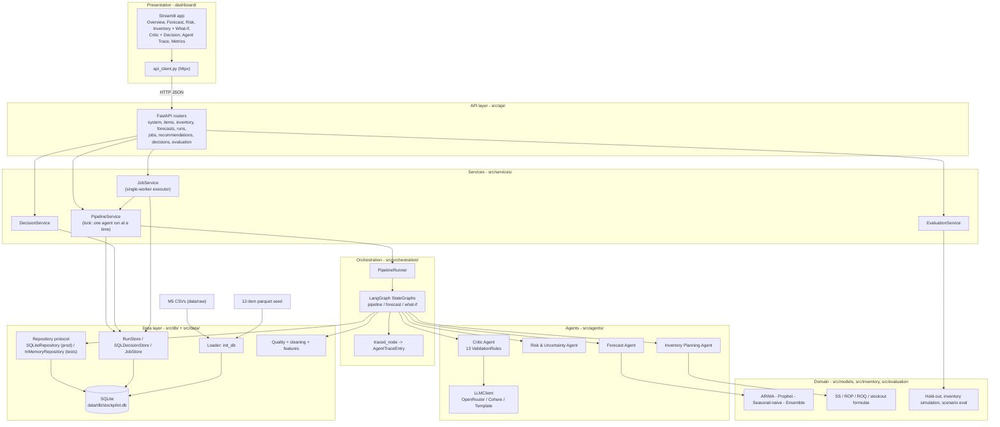
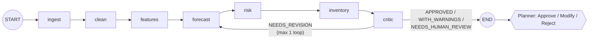
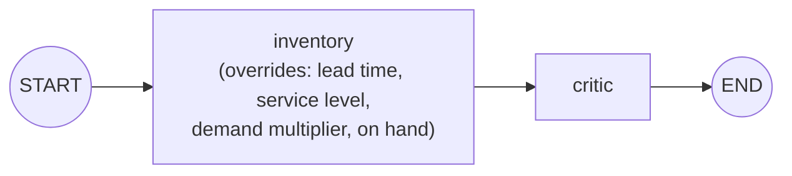
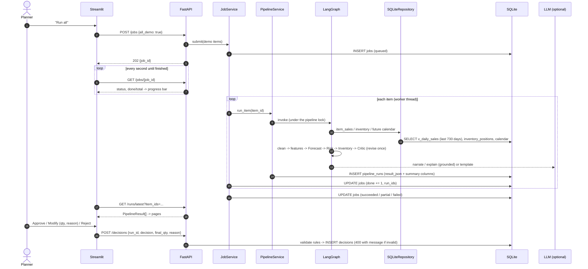
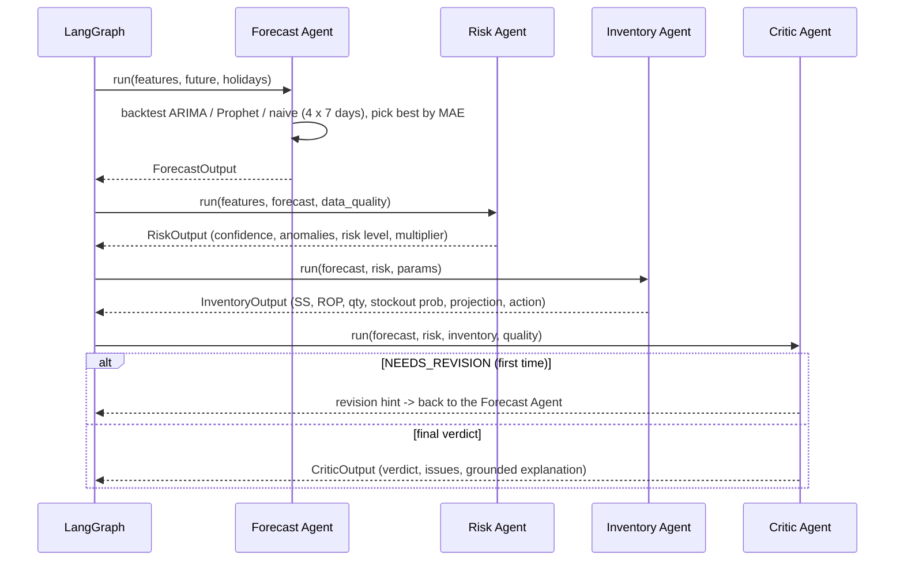
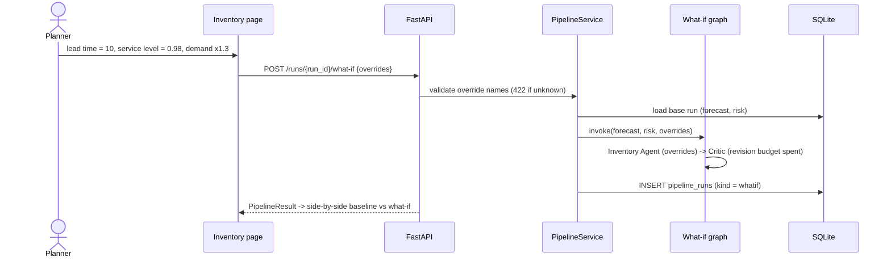
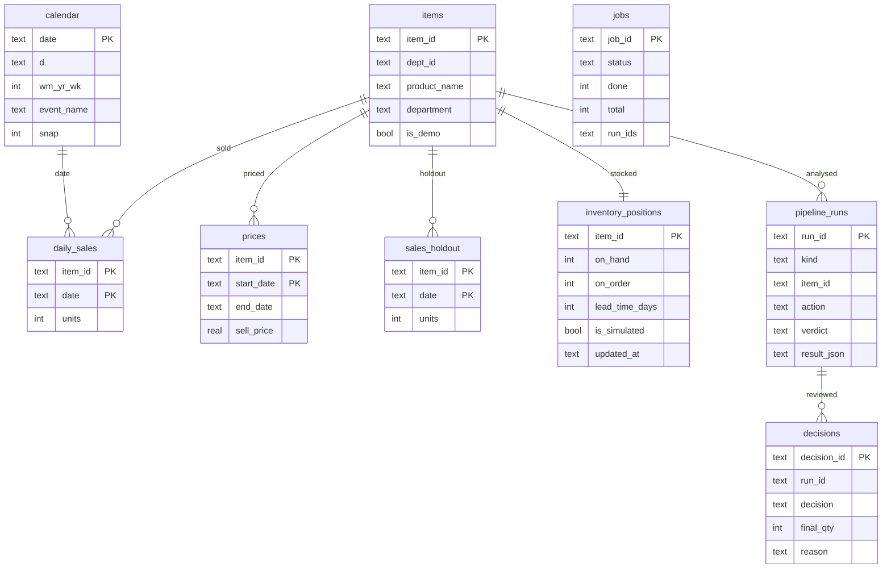

# Architecture

## 1. Layered view

Three tiers: a Streamlit client, a FastAPI service with the agent orchestration behind it,
and a SQLite data layer that the M5 CSVs are loaded into at initialisation.

Design principles:

* **Single responsibility.** Each agent owns one decision. Formulas live in pure functions
  (`src/inventory`, `src/agents/confidence.py`), so they can be unit-tested without agents.
* **Open/closed.** The Critic is a list of `ValidationRule` strategy objects, data sources
  implement `SalesDataSource`, forecasters implement `BaseForecaster` and LLM providers
  implement `LLMClient`. Each can be extended without touching its callers.
* **Dependency inversion.** Agents receive `Settings` and an `LLMClient`, and the graph
  receives a `PipelineDependencies` bundle whose repository satisfies the `Repository`
  protocol. Production uses `SQLiteRepository`; tests and the scenario evaluation inject an
  `InMemoryRepository`. Moving from SQLite to Postgres only changes the SQLAlchemy URL.
* **Thin HTTP layer.** Routers only translate HTTP to service calls. Business rules (decision
  validation, override checks, PO lines) live in services and stores, so scripts, tests and
  the API share them.
* **Typed contracts.** Agents communicate only through pydantic models (`ForecastOutput`,
  `RiskOutput`, `InventoryOutput`, `CriticOutput`). LangGraph state is a `TypedDict`.
* **Deterministic numbers, generative words.** Every number comes from code. The LLM only
  phrases explanations, and the grounding check rejects any sentence with an unknown number.

## 2. Agent workflow (LangGraph)

Forecast graph (`POST /forecasts/{item_id}`): `ingest -> clean -> features -> forecast ->
risk`, with no planning or critique and nothing stored.

What-if graph (reuses cached forecast and risk outputs; recomputes only the policy and
validation):

`PipelineState.trace` uses an `operator.add` reducer. Every node appends an
`AgentTraceEntry` (node, agent, input and output summary, reasoning, LLM provider, duration,
status). The trace is stored with the run in `pipeline_runs.result_json` and exported to
`outputs/traces/{run_id}.json`.

## 3. Sequence: background job, UI -> API -> graph -> SQLite

Inside the graph, one item runs as follows:

## 4. Sequence: what-if analysis

## 5. Data layer and persistence

`init_db` (run by `scripts/init_db.py` or on API start-up when the database is empty) loads
the whole CA_1 FOODS category from the raw M5 CSVs: 1,437 items, 2,789,217 daily rows and
1,969 calendar days, in about 10 seconds. Without the raw files it loads the committed
12-item parquet seed instead. Reloading (`--rebuild`) replaces only the data tables; runs,
decisions and jobs are kept.

* The `v_daily_sales` view joins `daily_sales`, `items`, `calendar` and `prices` back into
  the long `SALES_COLUMNS` frame the pipeline has always used. `SQLiteRepository` serves the
  last `history_days` (730) of that view per item, so for the 12 demo items the agents see
  exactly the frames the parquet subset produced. A regression test enforces this.
* Prices are stored as **price spells**: consecutive days with the same price compress to
  one row (5,570 rows instead of about 2.8M). M5 prices change weekly, but spells also
  represent sources whose prices change mid-week (for example the synthetic test data)
  without loss.
* Inventory positions for the demo items come from `data/simulated/inventory_params.csv`.
  All other items are simulated with the same seeded generator. `PUT
  /items/{id}/inventory` updates a row, like a stock feed would.
* The engine uses WAL journaling, so the API can serve reads while a background job writes.

| Artifact | Producer | Format |
|---|---|---|
| `data/db/stockpilot.db` | `init_db`, RunStore, DecisionStore, JobStore | SQLite (gitignored, rebuilt from the CSVs) |
| `data/processed/*.parquet` | `scripts/build_subset.py` | 12-item seed used when `data/raw` is absent |
| `data/simulated/inventory_params.csv` | seeded simulator | Demo-item inventory seed |
| `outputs/traces/{run_id}.json` | `save_trace` | Agent trace export per run |
| `outputs/logs/app.jsonl` | structlog | Structured JSON logs |
| `outputs/evaluation/*` | `scripts/run_evaluation.py` | Summary JSON and CSVs (served by `/evaluation/*`) |

## 6. Failure handling

| Failure | Behaviour |
|---|---|
| Raw M5 CSVs missing | `init_db` loads the 12-item parquet seed (then synthetic data, if allowed) and `/system/info` reports the source |
| Database empty | Data endpoints return 503 with the `init_db` command; `/health` reports `database: empty` |
| API unreachable | The dashboard shows a banner with the command to start the API |
| One item fails inside a job | The job continues; it ends `partial` with the error listed |
| ARIMA unstable or explosive | Sanity check, then enforced stationarity, then fallback orders; the model is excluded if still implausible |
| Prophet fails | The Forecast Agent continues with the remaining models |
| Critic finds a fixable forecast issue | One bounded revision loop (ensemble or alternative model) |
| Critic finds a critical or escalating issue | `NEEDS_HUMAN_REVIEW`, highlighted in the UI |
| LLM unavailable, rate-limited or ungrounded | Secondary provider, then deterministic template |
| Unknown what-if override | 422 before any agent runs, shown as a UI error |
| Invalid planner decision | 400 with a plain-language message, shown in the decision form |
