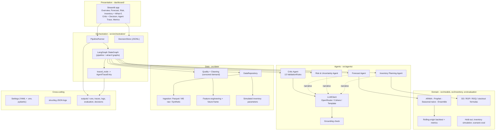
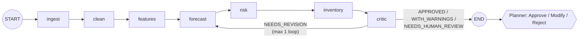
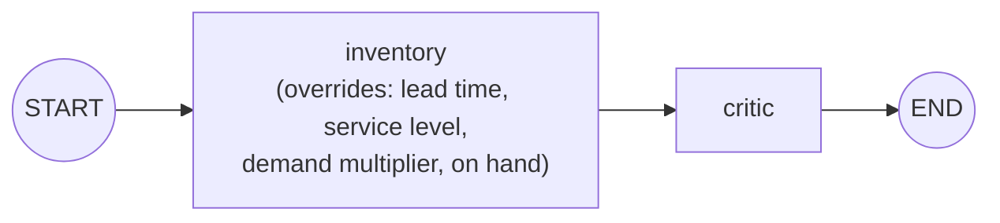
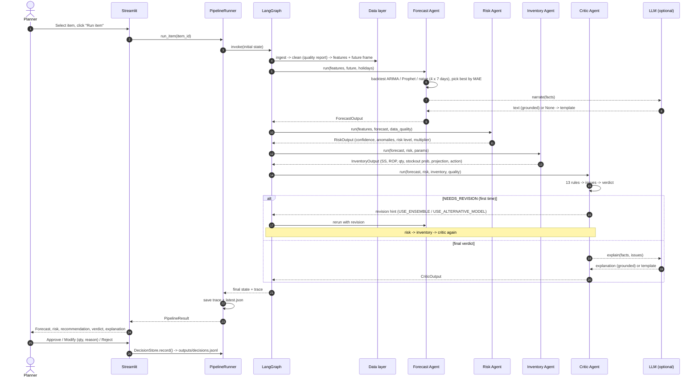
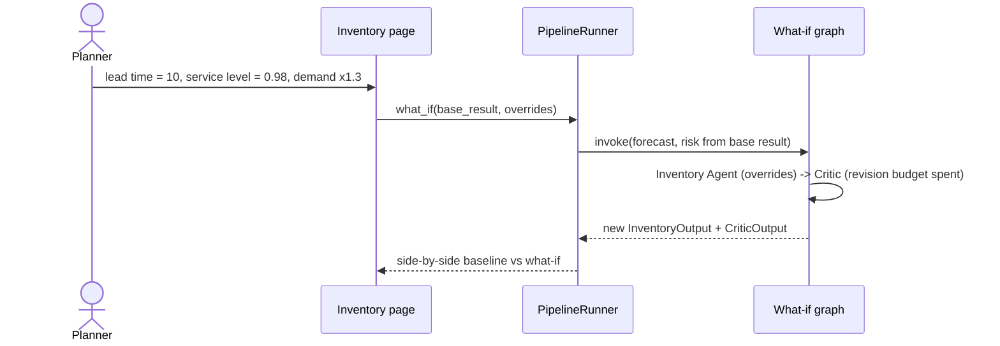

# Architecture

## 1. Layered view

Design principles:

* **Single responsibility.** Each agent owns one decision. Formulas live in pure functions
  (`src/inventory`, `src/agents/confidence.py`), so they can be unit-tested without agents.
* **Open/closed.** The Critic is a list of `ValidationRule` strategy objects, data sources
  implement `SalesDataSource`, forecasters implement `BaseForecaster` and LLM providers
  implement `LLMClient`. Each can be extended without touching its callers.
* **Dependency inversion.** Agents receive `Settings` and an `LLMClient`, and the graph
  receives a `PipelineDependencies` bundle. Tests inject synthetic data and fake LLMs.
* **Typed contracts.** Agents communicate only through pydantic models (`ForecastOutput`,
  `RiskOutput`, `InventoryOutput`, `CriticOutput`). LangGraph state is a `TypedDict`.
* **Deterministic numbers, generative words.** Every number comes from code. The LLM only
  phrases explanations, and the grounding check rejects any sentence with an unknown number.

## 2. Agent workflow (LangGraph)

What-if graph (reuses cached forecast and risk outputs; recomputes only the policy and
validation):

`PipelineState.trace` uses an `operator.add` reducer. Every node appends an
`AgentTraceEntry` (node, agent, input and output summary, reasoning, LLM provider, duration,
status), which is saved to `outputs/traces/{run_id}.json`.

## 3. Sequence: one item, end to end

## 4. Sequence: what-if analysis

## 5. Data flow and persistence

| Artifact | Producer | Format |
|---|---|---|
| `data/processed/sales_subset.parquet` | `scripts/build_subset.py` | Long format: date, item, units, price, events, SNAP |
| `data/processed/calendar_future.parquet` | same | Next 28 days of calendar, prices and events |
| `data/processed/actuals_future.parquet` | same | Real sales after the origin (evaluation only) |
| `data/simulated/inventory_params.csv` | `DataRepository` (seeded) | On hand, on order, lead time, MOQ, pack, cost |
| `outputs/runs/latest.json` | `PipelineRunner.save_results` | List of `PipelineResult` |
| `outputs/traces/{run_id}.json` | `save_trace` | Agent trace per run |
| `outputs/logs/app.jsonl` | structlog | Structured JSON logs |
| `outputs/decisions.jsonl` | `DecisionStore` | Human Approve / Modify / Reject audit log |
| `outputs/evaluation/*` | `scripts/run_evaluation.py` | Summary JSON and CSVs |

## 6. Failure handling

| Failure | Behaviour |
|---|---|
| No processed data | Ingestion falls back to synthetic data (dev) and the UI shows the data source |
| ARIMA unstable or explosive | Sanity check, then enforced stationarity, then fallback orders; the model is excluded if still implausible |
| Prophet fails | The Forecast Agent continues with the remaining models |
| Critic finds a fixable forecast issue | One bounded revision loop (ensemble or alternative model) |
| Critic finds a critical or escalating issue | `NEEDS_HUMAN_REVIEW`, highlighted in the UI |
| LLM unavailable, rate-limited or ungrounded | Secondary provider, then deterministic template |
| Unknown what-if override | `ValueError`, shown as a UI error |
