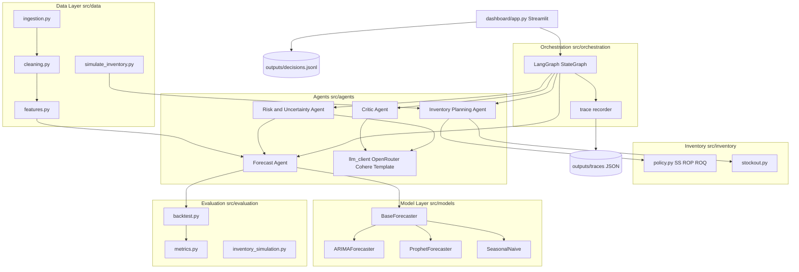
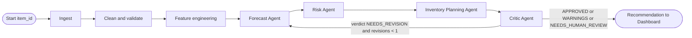
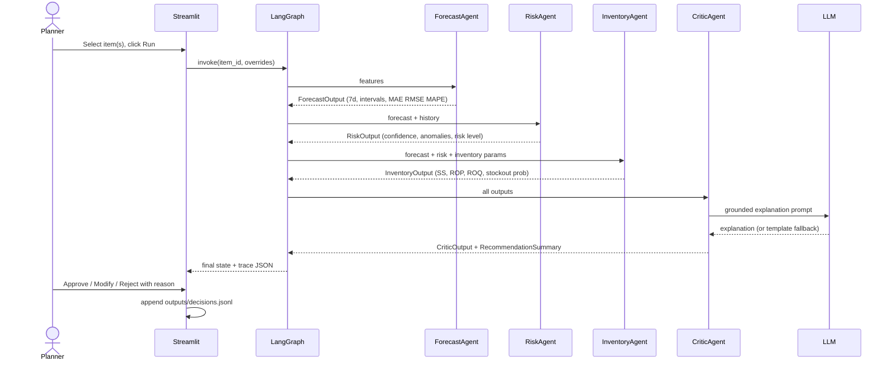

# Agentic Demand Forecasting and Inventory Reorder Recommendation System

This plan replaces the earlier StockPilot plan. Two pieces of the earlier plan are kept: the human Approve/Modify/Reject step on the final recommendation, and a What-if panel. The project is built at the repo root, so `StockAIPilot/` plays the role of `agentic-demand-forecasting/`.

## 1. Decisions

- **Dataset**: M5 Forecasting (Walmart, daily), store `CA_1`, category `FOODS`, 12 items, last 2 years (about 730 days). This keeps ARIMA and Prophet fits fast.
- **Forecast**: 7 daily steps per item. Models are ARIMA (statsmodels `SARIMAX`, seasonal period 7, small AIC grid) and Prophet (weekly and yearly seasonality, M5 events as holidays, SNAP and price as regressors). A seasonal-naive model is added only as a reference baseline.
- **Inventory**: rule-based safety stock, reorder point and order-up-to reorder quantity. Stock levels and lead times are **simulated** with a fixed seed and labelled as simulated.
- **LLM**: provider set through `.env` (`LLM_PROVIDER=openrouter|cohere|none`). The Critic uses it for business explanations and the final summary. The other agents produce deterministic results and add a short optional LLM narrative. If there is no API key or the call fails, a template is used, so the app always runs.
- **Human in the loop**: Approve, Modify or Reject in the dashboard, stored in `outputs/decisions.jsonl`. Nothing is ever ordered automatically.
- **Runtime**: Python 3.11 (`/opt/homebrew/bin/python3.11`, in a `.venv`). Prophet does not yet support the system Python 3.14.

## 2. Requirements summary

- **Data**: M5 `sales_train_evaluation.csv`, `calendar.csv`, `sell_prices.csv` (one-time Kaggle download needing a `~/.kaggle/kaggle.json` token). The processed subset is committed to `data/processed/` so a fresh clone runs without Kaggle. There is also a synthetic data generator used for tests.
- **Simulated inputs**: `data/simulated/inventory_params.csv` with `item_id, on_hand, on_order, lead_time_days, lead_time_std, moq, pack_size, unit_cost, holding_cost_rate, is_simulated`.
- **Agent outputs**: pydantic models `ForecastOutput`, `RiskOutput`, `InventoryOutput`, `CriticOutput`, `RecommendationSummary`.
- **Metrics**: MAE, RMSE, MAPE (on non-zero days, with WAPE reported too because of intermittent zeros), rolling-origin backtest.
- **Observability**: structlog JSON logs in `outputs/logs/`, one JSON trace per run in `outputs/traces/{run_id}.json`.
- **Dashboard pages**: Overview, Forecast, Risk, Inventory with What-if, Critic and Approval, Agent Trace, Performance Metrics.
- **Evaluation**: forecast accuracy; inventory KPI and stockout-reduction simulation against a naive reorder policy; a qualitative explainability rubric; Critic flag accuracy on injected scenarios.
- **Accounts**: Kaggle token, plus an OpenRouter or Cohere free key (optional).

## 3. Key dependencies (`requirements.txt`)

`pandas`, `numpy`, `pyarrow`, `scipy`, `statsmodels`, `prophet`, `scikit-learn`, `langgraph`, `langchain-core`, `langchain-openai` (OpenRouter through `base_url`), `langchain-cohere`, `pydantic>=2`, `pydantic-settings`, `pyyaml`, `python-dotenv`, `structlog`, `streamlit`, `plotly`, `kaggle`, `pytest`, `pytest-cov`, `ruff`. Versions will be pinned once they install cleanly on 3.11.

## 4. Architecture



Each layer depends only on the layers below it, and agents talk to models and engines through interfaces (dependency inversion). The models, the inventory engine and the metrics are pure and unit-testable, with no LLM involved.

## 5. Agent workflow (LangGraph)



- **State** (`PipelineState` TypedDict): `run_id, item_id, config, raw_df, clean_df, features_df, data_quality, forecast, risk, inventory, critic, revision_count, overrides, trace[]`.
- **Revision loop**: if the Critic finds a model problem (for example ARIMA and Prophet disagree by more than 35%, or the chosen model's backtest MAPE is above the threshold), it sends a hint back, such as `use_ensemble` or `use_alternative_model`. The Forecast Agent then runs once more. This is where the agents visibly collaborate.
- **Tracing**: a `@traced_node` decorator records `agent, started_at, duration_ms, inputs_summary, output (pydantic dump), reasoning_steps[], llm_provider, warnings`, and the recorder writes them to `outputs/traces/{run_id}.json`.

### Sequence (dashboard run)



## 6. Agent specifications

- **Forecast Agent** (`src/agents/forecast_agent.py`): backtests ARIMA, Prophet and Naive on 4 rolling 7-day folds (the last 28 days), picks the best by MAE (or an ARIMA+Prophet ensemble when the Critic asks for it), refits on the full history and forecasts 7 days with 80% intervals. Output: `ForecastOutput{item_id, model_used, forecast[date, yhat, lower, upper], metrics_by_model{MAE, RMSE, MAPE, WAPE}, model_agreement_pct}`.
- **Risk & Uncertainty Agent** (`src/agents/risk_agent.py`):
  - **Anomalies**: rolling z-score (|z| > 3) and IQR on the last 90 days; a spike means the last 7 days average more than 1.5x the 28-day mean.
  - **Confidence score** (0-100): \( 100 \times (0.4(1-\min(\text{WAPE},1)) + 0.3(1-\min(\text{rel. interval width},1)) + 0.2\,\text{agreement} + 0.1\,\text{data quality}) \)
  - **Risk level**: LOW at 70 or above, MEDIUM at 45-70, HIGH below 45, raised one level when there is a recent spike.
  - **Output**: `RiskOutput{confidence_score, risk_level, anomalies[], spike_detected, uncertainty_multiplier, narrative}`
- **Inventory Planning Agent** (`src/inventory/policy.py`, `stockout.py`):
  - `sigma_d` is adjusted by the risk `uncertainty_multiplier` (LOW 1.0, MEDIUM 1.2, HIGH 1.4).
  - Safety stock: \( SS = z\sqrt{L\sigma_d^2 + \mu_d^2\sigma_L^2} \), with z from the service level (default 95%).
  - Reorder point: \( ROP = \mu_d L + SS \)
  - Reorder quantity: \( ROQ = \max(0, \mu_d(L+R) + SS - IP) \), rounded up to the pack size and at least the MOQ. EOQ is shown for reference.
  - Stockout probability: \( 1-\Phi\big((IP-\mu_d L)/(\sigma_d\sqrt{L})\big) \), plus days of cover and the projected stockout date.
  - Output: `InventoryOutput{safety_stock, reorder_point, reorder_qty, inventory_position, days_of_cover, stockout_probability, projected_stockout_date, action: REORDER|HOLD|EXPEDITE}`.
- **Critic Agent** (`src/agents/critic_agent.py`):
  - **Validation rules**, defined as Strategy classes in `src/agents/validation_rules.py`: non-negative forecasts; `lower <= yhat <= upper`; MAPE over the threshold; model disagreement; ROQ above 30 days of cover; safety stock above 3x mean daily demand; HIGH risk combined with HOLD; low confidence combined with a large order; data-quality issues; simulated-data notice.
  - **Verdict**: `APPROVED`, `APPROVED_WITH_WARNINGS`, `NEEDS_REVISION` (sends the run back through the loop) or `NEEDS_HUMAN_REVIEW`.
  - **Explanation**: the LLM receives only a JSON of the validated numbers. A grounding check makes sure every number in the explanation appears in that input; otherwise the template explanation is used.
  - **Output**: `CriticOutput{verdict, issues[{rule, severity, message}], explanation, recommendation: RecommendationSummary{action, qty, rationale, key_risks, confidence}}`.

## 7. Directory structure

```
StockAIPilot/
├── README.md  requirements.txt  pyproject.toml  .env.example  .gitignore
├── config/settings.yaml               # items, horizon, thresholds, service level, model params
├── data/{raw/, processed/, simulated/}
├── notebooks/01_eda.ipynb  02_forecast_experiments.ipynb
├── scripts/download_m5.py  build_subset.py  run_pipeline.py  run_evaluation.py
├── src/
│   ├── config/settings.py             # pydantic-settings, YAML + env
│   ├── data/ingestion.py cleaning.py features.py quality.py simulate_inventory.py synthetic.py
│   ├── models/base.py arima_model.py prophet_model.py naive_model.py ensemble.py
│   ├── agents/schemas.py base_agent.py forecast_agent.py risk_agent.py inventory_agent.py
│   │          critic_agent.py validation_rules.py llm_client.py prompts.py anomaly.py confidence.py
│   ├── inventory/policy.py stockout.py
│   ├── orchestration/state.py graph.py tracing.py runner.py
│   ├── evaluation/metrics.py backtest.py inventory_simulation.py scenario_eval.py
│   ├── logging/logger.py              # structlog JSON config
│   └── utils/io.py dates.py
├── dashboard/app.py  pages/{overview,forecast,risk,inventory,critic_approval,trace,metrics}.py  components/charts.py
├── tests/ test_config test_ingestion test_cleaning test_features test_models test_metrics
│          test_risk test_inventory test_critic test_graph test_llm_fallback (+ conftest with synthetic data)
├── docs/architecture.md roadmap.md dataset.md agent_design.md evaluation_report.md demo_script.md
└── outputs/{traces/, logs/, runs/, decisions.jsonl, evaluation/}
```

The `src/logging/` package must not shadow the standard library `logging`. All imports are absolute (`from src.logging.logger import get_logger`), and no module inside `src/` does a bare `import logging` from within that package. The existing `requirement_checlist.md` moves into `docs/`.

## 8. Dashboard (`streamlit run dashboard/app.py`)

- **Sidebar**: item selector (one or all), service level, Run Pipeline button, LLM provider status, a "Simulated inventory" badge. Results are cached in `st.session_state` and in `outputs/runs/latest.json`, which is precomputed by `scripts/run_pipeline.py` so the first load is instant.
- **Overview**: KPI tiles and a recommendation table (item, action, quantity, risk, confidence, verdict).
- **Forecast**: actuals, ARIMA, Prophet and the 80% band, plus a backtest metrics table per model.
- **Risk**: confidence gauge, anomaly markers on the history, spike flag, risk explanation.
- **Inventory**: SS/ROP/ROQ cards, projected stock vs ROP chart, and **What-if** sliders (lead time, service level, demand multiplier, on-hand). Changing a slider reruns only the Inventory and Critic nodes.
- **Critic & Approval**: verdict, issues by severity, business explanation, and Approve/Modify/Reject with a mandatory reason.
- **Agent Trace**: timeline of nodes with durations, expandable JSON per agent, trace file download.
- **Performance Metrics**: MAE/RMSE/MAPE/WAPE per item and model, and the stockout-simulation results.

## 9. Evaluation (Phase 9)

- **Forecast accuracy**: rolling backtest comparing ARIMA, Prophet, Ensemble and Naive.
- **Inventory KPI simulation**: replay the last 56 days day by day using actual demand. Compare the agentic policy (SS/ROP/ROQ from the forecast) against a naive policy (reorder a fixed quantity when stock falls below 7 x the 28-day average). Report stockout days, fill rate, average inventory and number of orders.
- **Scenario evaluation**: 10-15 injected scenarios (demand spike, missing price, zero streak, long lead time, inflated on-hand). Measure Critic flag precision and recall, and the grounding pass rate.
- **Qualitative**: explainability rubric (1-5) and an agent-collaboration review, written up in `docs/evaluation_report.md`.

## 10. Implementation approach

Each phase follows your required format. Before writing code I'll post a short note covering purpose, dependencies and design decisions. The code then gets full type hints, docstrings on public functions and the tests for that module. Every phase ends with `pytest` and `ruff` passing before the next one starts. The commands used are `python3.11 -m venv .venv`, `pip install -r requirements.txt`, `python scripts/build_subset.py`, `python scripts/run_pipeline.py` and `streamlit run dashboard/app.py`.

**Network caveat**: downloading from Kaggle needs your token and may need network permission outside the sandbox. If it isn't available, I'll build everything on the synthetic M5-shaped generator first and switch to the real subset as soon as the download works.
